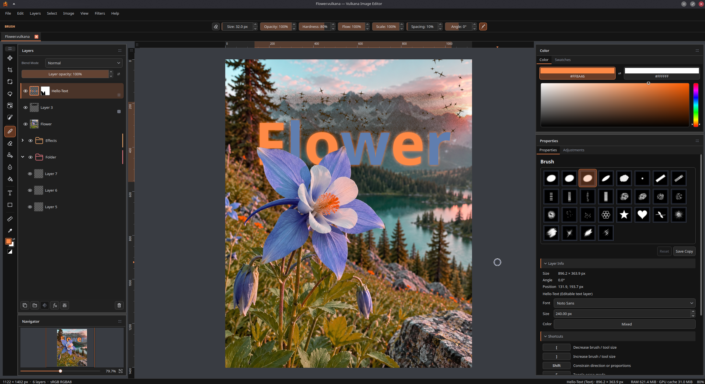

# Vulkana — Editor di immagini

<!-- readme-languages:start -->
[English](../../README.md) · [Français](README.fr.md) · [Español](README.es.md) · [Deutsch](README.de.md) · [Italiano](README.it.md) · [Português (Brasil)](README.pt-BR.md) · [Polski](README.pl.md) · [Türkçe](README.tr.md) · [Русский](README.ru.md) · [Українська](README.uk.md) · [العربية](README.ar.md) · [हिन्दी](README.hi.md) · [简体中文](README.zh-Hans.md) · [繁體中文](README.zh-Hant.md) · [日本語](README.ja.md) · [한국어](README.ko.md)
<!-- readme-languages:end -->

Un editor di immagini pensato principalmente per Linux, per dipingere, ritoccare
e creare composizioni a livelli, disponibile anche in versioni native per Windows,
con un’area di lavoro Qt e una tela accelerata da Vulkan.



## Funzionalità

- **Modifica a livelli:** livelli raster, testo e forme modificabili; maschere
  bitmap, cartelle, gruppi di maschere di ritaglio, selezione multipla, metodi di
  fusione, duplicazione, unione e rasterizzazione esplicita.
- **I progetti collegati e i livelli specchio** permettono di riutilizzare un
  disegno. Fai doppio clic su un [livello di progetto](../PROJECT_LAYERS.md)
  per modificarne la sorgente, poi torna al progetto principale per vedere le
  modifiche. Un [livello specchio](../MIRRORED_LAYERS_AND_GUIDES.md) segue le
  modifiche della sorgente nello stesso documento e può avere una trasformazione
  ed effetti propri.
- **Gruppi di canali:** modifica i singoli canali come livelli in scala di grigi
  per texture con dati combinati, con conversione senza perdita, pittura numerica,
  ritocco e regolazioni. Consulta la [guida ai gruppi di canali](../CHANNEL_GROUPS.md).
- **Gli strumenti di pittura e ritocco** includono pennelli sensibili alla
  pressione, riempimento, sfocatura locale, timbro clone e strumenti correttivi.
  La [simmetria del pennello](../BRUSH_SYMMETRY.md) riflette i tratti rispetto
  a un asse mobile, anche sulle maschere di livello. Il correttivo al volo può
  riempire buchi trasparenti e campionare i livelli visibili sopra e sotto il
  livello di ritocco.
- **Selezioni:** rettangolo, ellisse, lazo a mano libera/poligonale/magnetico,
  selezione per colore e selezione rapida guidata dal pennello, con espansione,
  contrazione, inversione e ripristino della selezione.
- **Selezione oggetto e perfezionamento:** seleziona un oggetto tracciando un
  rettangolo approssimativo, tramite il modello offline incluso; migliora le
  selezioni e le maschere bitmap con Perfeziona selezione, anteprime in tempo reale
  e correzioni manuali. Per usare Selezione oggetto non occorre scaricare un modello
  né installare Python.
- **La modifica locale con IA** permette di generare immagini, modificare livelli
  e riempire selezioni con i tuoi modelli e LoRA. Confronta i risultati prima
  di applicarli. Qwen-Image-Layered può scomporre un’immagine in una cartella di
  livelli modificabili. Le versioni distribuite includono Vulkan. Per le GPU
  NVIDIA è disponibile un motore CUDA separato. Consulta
  [Vulkana Diffusion](../../DIFFUSION.md) per la configurazione e i requisiti
  della GPU.
- **Le trasformazioni** permettono di spostare, ridimensionare, ruotare,
  riflettere o distorcere dagli angoli livelli, contorni di selezione e pixel
  selezionati. Posiziona una guida al centro o più guide a intervalli regolari
  per allineare i livelli con l’aggancio.
- **Regolazioni non distruttive:** correzioni per livello e livelli di regolazione
  con maschera, applicabili a tutti i livelli sottostanti o al gruppo corrente;
  esposizione, valori tonali, curve, tonalità/saturazione, vividezza, bilanciamento
  colore, calore/tinta, conversione monocromatica e inversione.
- **Filtri ed effetti di livello:** sfocatura gaussiana, di movimento e obiettivo;
  traccia, ombra esterna/interna, bagliore esterno/interno, sovrapposizione colore,
  sovrapposizione sfumatura, smusso ed effetto rilievo.
- **Le schede dei documenti** conservano ciascuna la propria cronologia, le
  proprie selezioni e il proprio zoom. Duplica una scheda per fare delle prove
  su una copia non salvata, copia livelli tra documenti o trascina le immagini
  nel pannello Livelli per inserirle nella pila.
- **La pulizia dei livelli** include un’anteprima della trasparenza che puoi
  ingrandire per esaminare i capelli e i bordi sfumati. «Cancella selezione inversa»
  cancella i pixel esterni alla selezione e la mantiene attiva.
  «Ritaglia ai limiti della tela» rimuove dai livelli selezionati i pixel
  esterni alla tela.
- **L’importazione PSD** permette di verificare la conversione in livelli
  nativi, testo formattato, forme semplici, maschere bitmap, gruppi di ritaglio
  e stili supportati. Verifica perché è necessaria una conversione e applica la
  stessa scelta ai livelli dello stesso tipo in un solo passaggio.
- **Esportazione PSD:** output a livelli o unificato, testo/forme/maschere
  modificabili e ritaglio ove supportato, con verifica delle conversioni e una
  nuova immagine composita.
- **Importazione PDF:** pagine selezionate ai PPI desiderati, come livelli raster
  o documenti separati, con sfondo trasparente o bianco.
- **Esportazione PDF:** un’immagine composita oppure livelli/gruppi come pagine,
  selezione personalizzata delle pagine, dimensioni della tela o adattate al
  contenuto e testo selezionabile ove supportato.
- **Area di lavoro e output:** pannelli agganciabili a schede, un navigatore con
  controlli di spostamento e zoom, temi, scorciatoie modificabili, righelli,
  anteprima pixel, progetti nativi `.vulkana` ed esportazione PNG/JPEG/WebP.
  Esporta i livelli selezionati ritagliandoli sull’area che racchiude il loro
  contenuto visibile, oppure adatta le dimensioni della tela al livello selezionato.
- **Lingue:** 16 lingue dell’interfaccia, selezionabili in Preferenze → Generali →
  Lingua senza riavviare. Tutte le versioni linguistiche sono prime bozze;
  chiunque può contribuire con revisioni e correzioni.

Versione beta in sviluppo attivo. Conserva copie di backup dei progetti importanti.

## Compilazione ed esecuzione

Le compilazioni per Linux e Windows sono destinate a x86-64. Clona il repository,
poi esegui i comandi per la tua piattaforma dalla sua radice:

```sh
git clone https://github.com/Kaidoom/VulkanaImageEditor.git
cd VulkanaImageEditor
```

### Linux

Richiede Linux, un compilatore C++20, Ninja, pkg-config e queste librerie di sviluppo:

- CMake **3.28+** per i preset forniti.
- Qt **6.8+**: Core, Gui, Widgets, Network, DBus e PDF; Qt Test per i test.
- Qt Linguist `lrelease` e Python 3 per compilare i pacchetti di lingua (solo strumenti di compilazione).
- Libreria di sviluppo qpdf **11+** (importazione/esportazione PDF; non lo strumento a riga di comando).
- Libreria di sviluppo compatibile con zlib (canali ZIP dei file PSD).
- Header e loader Vulkan **1.2+**, un driver Vulkan funzionante e `glslc`.
- minizip-ng **4.x** (il modulo pkg-config `minizip`, non il vecchio minizip).
- libwebp e libwebpmux **1.2+**.

Installa i plugin di piattaforma di Qt per il tuo desktop, il supporto SVG e i
plugin dei formati immagine. Imposta `CMAKE_PREFIX_PATH` in modo che punti alla tua
installazione di Qt se si trova fuori dai percorsi di ricerca del sistema.
Qt PDF è un pacchetto di sviluppo separato in molte distribuzioni (per esempio
`qt6-qtpdf-devel` su Fedora, `qt6-pdf-dev` su Ubuntu). Non richiede un browser
WebEngine durante l’esecuzione di Vulkana.
Gli strumenti Qt Linguist sono forniti da `qt6-linguist` su Fedora o
`qt6-tools-dev-tools` su Ubuntu. Imposta `-DVULKANA_LRELEASE=/path/to/lrelease`
se necessario. I cataloghi delle finestre di dialogo standard di Qt provengono da
`qt6-qttranslations` su Fedora o `qt6-translations-l10n` su Ubuntu. Consulta la
[documentazione sulla localizzazione](../LOCALIZATION.md) per compilare soltanto
i pacchetti di lingua e verificarli.

Dalla radice del repository:

```sh
cmake --preset release -DIMAGEEDITOR_BUILD_TESTS=OFF
cmake --build --preset release --parallel
./build/release/src/app/imageeditor
```

È anche possibile passare progetti e immagini come argomenti:

```sh
./build/release/src/app/imageeditor "project.vulkana" "photo.webp"
```

Qt sceglie Wayland o X11 in base alla sessione. Le preferenze e le preimpostazioni
personalizzate sono salvate nello spazio di archiviazione del singolo utente.
I servizi online sono facoltativi; senza la
[configurazione dei servizi](../../config/SERVICES.md), gli aggiornamenti e
l’invio di feedback restano disattivati.

Per i test Release, abilita i target di test e ricompila:

```sh
cmake --preset release -DIMAGEEDITOR_BUILD_TESTS=ON
cmake --build --preset release --parallel 6
ctest --preset release
```

È disponibile anche il preset debug. Le verifiche del rendering nativo richiedono
i livelli di validazione Vulkan. Alcuni test di interazione richiedono un desktop
Wayland/X11 attivo.

### Windows

Installa i prerequisiti indicati nella [guida alla compilazione per Windows](../../tools/windows/README.md#prerequisites).
Apri Windows PowerShell nella radice del repository, poi compila e avvia l’applicazione:

```powershell
powershell.exe -NoProfile -ExecutionPolicy RemoteSigned -File tools/windows/Build.ps1
C:\Dev\Vulkana\stage\bin\imageeditor.exe
```

Lo script prepara le dipendenze e crea una compilazione Release con i pacchetti lingua.
Consulta la guida per [personalizzare i percorsi di compilazione](../../tools/windows/README.md#configuration),
[eseguire i test](../../tools/windows/README.md#testing) e
[creare cartelle portabili](../../tools/windows/README.md#portable-folder).

## Architettura

- `src/core` — documenti, livelli, geometria, algoritmi di elaborazione delle
  immagini e transazioni annullabili, indipendenti dalla piattaforma.
- `src/render` — tela Vulkan condivisa, composizione, sovrapposizioni e cache GPU di dimensioni limitate.
- `src/ui` — pannelli Qt, strumenti, schede dei documenti, preparazione di testo
  e forme e I/O dei file.
- `src/platform` — ricerca delle risorse, integrazione con il desktop e servizi facoltativi.
- `src/app` — punto di ingresso dell’applicazione; `shaders` — sorgenti degli shader Vulkan.

Ogni documento possiede contenuti e cronologia propri; le schede condividono
un’area di lavoro e un renderer Vulkan. I dati sorgente modificabili restano
separati dalle cache di rendering. Tela, anteprima pixel ed esportazione
condividono le stesse regole di composizione.

Consulta la [documentazione per sviluppatori](../README.md), la [guida all’architettura](../ARCHITECTURE.md)
e la [guida alla configurazione e agli strumenti MCP](../MCP.md).

## Licenza

Il codice, la documentazione e le risorse di proprietà di Vulkana sono distribuiti
[con licenza MIT](../../LICENSE). Il materiale di terze parti conserva le proprie
licenze; consulta gli [avvisi sulle terze parti](../../THIRD_PARTY.md).
