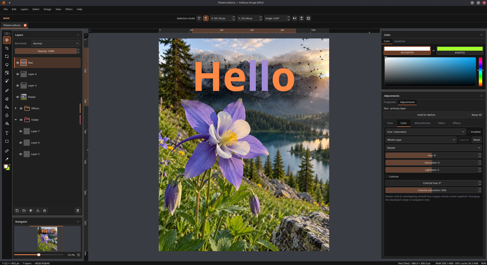

# Vulkana — Editor de imagens

<!-- readme-languages:start -->
[English](../../README.md) · [Français](README.fr.md) · [Español](README.es.md) · [Deutsch](README.de.md) · [Italiano](README.it.md) · [Português (Brasil)](README.pt-BR.md) · [Polski](README.pl.md) · [Türkçe](README.tr.md) · [Русский](README.ru.md) · [Українська](README.uk.md) · [العربية](README.ar.md) · [हिन्दी](README.hi.md) · [简体中文](README.zh-Hans.md) · [繁體中文](README.zh-Hant.md) · [日本語](README.ja.md) · [한국어](README.ko.md)
<!-- readme-languages:end -->

Um editor de imagens desenvolvido principalmente para Linux, para pintura,
retoque e composição em camadas, com uma área de trabalho Qt e uma tela acelerada por Vulkan.



## Recursos

- **Edição em camadas:** camadas raster, texto e formas editáveis; máscaras bitmap,
  pastas, grupos de máscaras de corte, seleção múltipla, modos de mesclagem,
  duplicação, mesclagem e rasterização explícita.
- **Pintura e retoque:** pincéis sensíveis à pressão, predefinições procedurais
  e texturizadas, borracha, preenchimento, desfoque local, carimbo de clonagem,
  pincel de recuperação e recuperação localizada automática.
- **Seleções:** retângulo, elipse, laço à mão livre/poligonal/magnético, seleção
  por cor e seleção rápida guiada por pincel, com expansão, contração, inversão
  e recuperação da seleção.
- **Seleção de objetos e refinamento:** selecione um objeto com um retângulo
  aproximado usando o modelo offline incluído; melhore seleções e máscaras bitmap
  com Refinar seleção, prévias em tempo real e correções manuais. A seleção de
  objetos não exige baixar um modelo nem instalar Python.
- **Transformações:** mover, redimensionar, girar, espelhar e distorcer pelos
  cantos; transforme os limites da seleção ou os pixels selecionados, com encaixe
  e guias de alinhamento.
- **Ajustes não destrutivos:** correções por camada e camadas de ajuste com máscara,
  aplicadas a todas as camadas abaixo ou ao grupo atual; exposição, níveis, curvas,
  matiz/saturação, vibração, equilíbrio de cores, calor/matiz, conversão
  monocromática e inversão.
- **Filtros e efeitos de camada:** desfoque gaussiano, de movimento e de lente;
  traçado, sombra projetada/interna, brilho externo/interno, sobreposição de cor,
  sobreposição de degradê e chanfro e entalhe.
- **Vários documentos:** abas com histórico, seleções e estado de visualização
  independentes, além de cópia de camadas editáveis entre documentos.
- **Importação PSD:** conversão com revisão para camadas nativas, texto formatado,
  formas simples, máscaras bitmap, grupos de corte e estilos compatíveis, com
  uso explícito das versões raster salvas quando necessário.
- **Exportação PSD:** saída em camadas ou achatada, texto/formas/máscaras editáveis
  e recorte quando compatível, com revisão das conversões e uma imagem composta
  gerada novamente.
- **Importação PDF:** páginas selecionadas no PPI desejado, como camadas raster
  ou documentos separados, com fundo transparente ou branco.
- **Exportação PDF:** uma imagem composta ou camadas/grupos como páginas, seleção
  personalizada de páginas, dimensões da tela ou ajustadas ao conteúdo e texto
  selecionável quando compatível.
- **Área de trabalho e saída:** painéis acopláveis com abas, um navegador com
  controles de deslocamento e zoom, temas, atalhos editáveis, réguas, prévia de
  pixels, projetos nativos `.vulkana` e exportação PNG/JPEG/WebP.
- **Idiomas:** 16 idiomas de interface, selecionáveis em Preferências → Geral →
  Idioma sem reiniciar. As novas traduções são uma primeira versão; correções
  são bem-vindas.

Versão beta em desenvolvimento ativo. Mantenha cópias de segurança de projetos importantes.

## Compilar e executar

Requer Linux, um compilador C++20, Ninja, pkg-config e estas bibliotecas de desenvolvimento:

- CMake **3.28+** para as predefinições fornecidas.
- Qt **6.8+**: Core, Gui, Widgets, Network, DBus e PDF; Qt Test para os testes.
- Qt Linguist `lrelease` e Python 3 para compilar pacotes de idiomas (apenas ferramentas de compilação).
- Biblioteca de desenvolvimento qpdf **11+** (importação/exportação PDF; não a ferramenta de linha de comando).
- Biblioteca de desenvolvimento compatível com zlib (canais ZIP de PSD).
- Cabeçalhos e carregador Vulkan **1.2+**, um driver Vulkan funcional e `glslc`.
- minizip-ng **4.x** (o módulo pkg-config `minizip`, não o minizip antigo).
- libwebp e libwebpmux **1.2+**.

Instale os plugins de plataforma do Qt para o seu ambiente gráfico, o suporte
a SVG e os plugins de formatos de imagem. Aponte `CMAKE_PREFIX_PATH` para sua
instalação do Qt se ela estiver fora dos caminhos de busca do sistema.
O Qt PDF é um pacote de desenvolvimento separado em muitas distribuições (por
exemplo, `qt6-qtpdf-devel` no Fedora e `qt6-pdf-dev` no Ubuntu). Ele não exige
um navegador WebEngine durante a execução do Vulkana.
As ferramentas do Qt Linguist são fornecidas por `qt6-linguist` no Fedora ou
`qt6-tools-dev-tools` no Ubuntu. Defina `-DVULKANA_LRELEASE=/path/to/lrelease`
se necessário. Os catálogos das caixas de diálogo padrão do Qt vêm de
`qt6-qttranslations` no Fedora ou `qt6-translations-l10n` no Ubuntu. Consulte a
[documentação de localização](../LOCALIZATION.md) para compilar somente os pacotes
de idiomas e revisá-los.

Na raiz do repositório:

```sh
cmake --preset release -DIMAGEEDITOR_BUILD_TESTS=OFF
cmake --build --preset release --parallel
./build/release/src/app/imageeditor
```

Projetos e imagens também podem ser passados como argumentos:

```sh
./build/release/src/app/imageeditor "project.vulkana" "photo.webp"
```

O Qt escolhe Wayland ou X11 de acordo com a sessão. As preferências e predefinições
personalizadas ficam no armazenamento de cada usuário. Os serviços online são
opcionais; sem a [configuração dos serviços](../../config/SERVICES.md), as
atualizações e o envio de comentários permanecem desativados.

Para desenvolvimento e testes:

```sh
cmake --preset debug
cmake --build --preset debug --parallel
ctest --preset debug
```

As verificações de renderização em modo debug ou nativo precisam das camadas de
validação do Vulkan. Alguns testes de interação exigem um ambiente gráfico
Wayland/X11 em execução.

## Arquitetura

- `src/core` — documentos, camadas, geometria, algoritmos de imagem e transações
  que podem ser desfeitas, independentes de plataforma.
- `src/render` — tela Vulkan compartilhada, composição, sobreposições e caches
  de GPU com tamanho limitado.
- `src/ui` — painéis Qt, ferramentas, abas de documentos, preparação de texto
  e formas e entrada/saída de arquivos.
- `src/platform` — busca de recursos, integração com o ambiente gráfico e serviços opcionais.
- `src/app` — ponto de entrada do aplicativo; `shaders` — código-fonte dos shaders Vulkan.

Cada documento possui seu próprio conteúdo e histórico; as abas compartilham
uma área de trabalho e um renderizador Vulkan. Os dados de origem editáveis
permanecem separados dos caches de renderização. A tela, a prévia de pixels e
a exportação compartilham as mesmas regras de composição.

Consulte a [documentação para desenvolvedores](../README.md) e o
[guia de arquitetura](../ARCHITECTURE.md).

## Licença

O código, a documentação e os recursos de propriedade do Vulkana estão
[sob a licença MIT](../../LICENSE). O material de terceiros mantém suas próprias
licenças; consulte os [avisos de terceiros](../../THIRD_PARTY.md).
